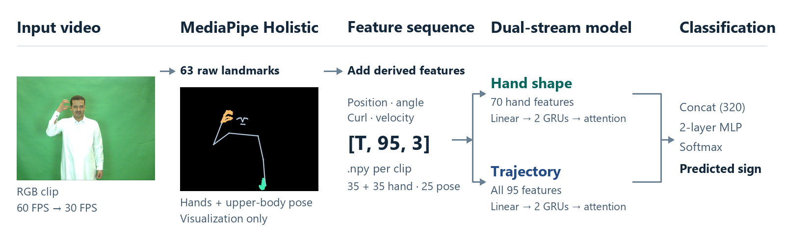
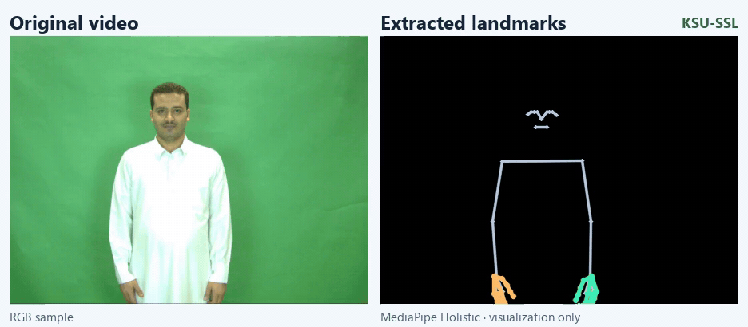
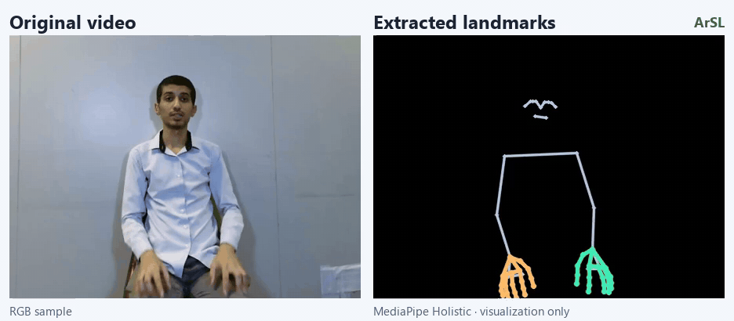
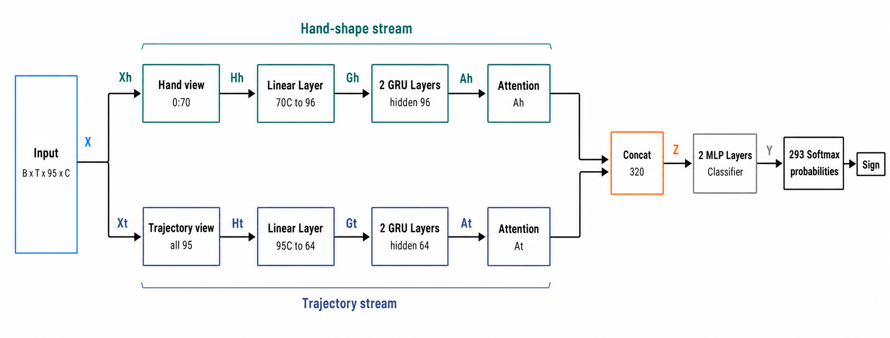

# Lightweight Landmark-Based Dual-Stream Isolated Sign Language Recognition | May 2026

This project at **King Saud University’s [Center of Smart Robotics Research (CS2R)](https://www.cs2r.net/)** explores lightweight recognition of Isolated Sign Language based on the Landmarks through a dual stream model. The model learns hand shape and the motion of the hands and upper body in separate streams. It takes landmark sequences as input and is evaluated on both familiar and held-out signers using **KSU-SSL** and **ArSL** Datasets.

The system is designed for isolated sign recognition across sign languages. Current experiments evaluate Saudi Sign Language and Arabic Sign Language on KSU-SSL and ArSL, respectively.

**Paper** · Soon

**Model size** · 2.1 MB &nbsp; | &nbsp; **Trainable parameters** · 530,150

## Results

### KSU-SSL

The signer-dependent experiment varies the number of training repetitions. The signer-independent experiment varies the number of training signers. The table shows the configurations with three repetitions and 25 signers, respectively.

| Evaluation mode | Training pool | Validation | Test | Top-1 accuracy |
| --- | --- | --- | --- | ---: |
| Signer-dependent | All signers, repetitions 1–3 | 10% held out from the training pool | All signers, repetition 4 | **99.3%** |
| Signer-independent | Signers 1–25, all repetitions | 10% held out from the training pool | Signers 26–32, all repetitions | **95.9%** |

### ArSL

| Evaluation mode | Training | Validation | Test | Accuracy |
| --- | --- | --- | --- | ---: |
| Signer-dependent | All signers, repetitions 1–3 | All signers, repetition 5 | All signers, repetition 4 | **99.5%** |
| Signer-independent | Signers 1, 2, and 10–31 | Signers 3–9 and 40 | Signers 32–39 | **98.1%** |

## Datasets and landmark demos

The examples pair an RGB sample from each dataset with the MediaPipe hand and upper-body landmarks extracted from the same frames. The black-background pose videos are for visualization only. The recognition model consumes the numeric landmark and feature sequences stored as `.npy` arrays.

### KSU-SSL

King Saud University Saudi Sign Language dataset.

[Original sample](KSU_SSL_Sample.mp4) · [Landmark video](assets/ksu-ssl-landmarks.mp4) · [Dataset paper](https://doi.org/10.1016/j.jksuci.2023.101642)

### ArSL

Arabic Sign Language dataset.

[Original sample](ArSL_sample.mp4) · [Landmark video](assets/arsl-landmarks.mp4) · [Dataset paper](https://doi.org/10.1109/ACCESS.2021.3069714)

## Approach

### Preprocessing and features

Videos recorded at 60 FPS are downsampled to 30 FPS. MediaPipe Holistic extracts 21 landmarks for each hand and 21 upper-body landmarks. The pipeline adds position, angle, curl, and velocity features to form a `[T, 95, 3]` array per clip. Here `T` is the number of frames and the three channels follow the `(x, y, z)` convention.

| Group | Features per frame | Composition |
| --- | ---: | --- |
| Left hand | 35 | 21 landmarks, 5 position features, 4 angle features, 5 curl features |
| Right hand | 35 | 21 landmarks, 5 position features, 4 angle features, 5 curl features |
| Upper-body pose | 25 | 21 landmarks, 2 position features, 2 velocity features |
| **Total** | **95** | **63 landmarks and 32 derived features** |

### Dual-stream recognition model

The model receives a batch shaped `[B, T, 95, C]`, where `C = 3 (x,y,z)`.

| Stream | Feature slice | Linear projection | Temporal encoder |
| --- | --- | --- | --- |
| Hand shape | `0:70` (both hands) | `70 × C → 96` | Two GRU layers, hidden size 96, followed by attention |
| Trajectory | All 95 features | `95 × C → 64` | Two GRU layers, hidden size 64, followed by attention |

The attention outputs concatenate into a **320-dimensional** representation. A two-layer MLP maps it to class logits. For KSU-SSL, softmax produces probabilities over **293 signs**, and the highest probability determines the predicted sign.

